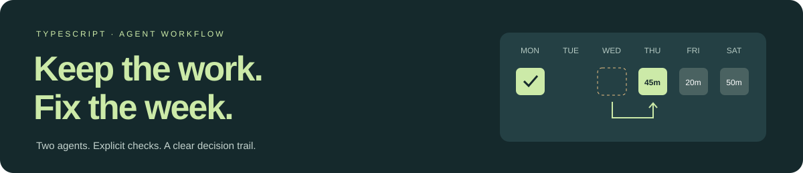

# Week Repair

### [Open the HTML report →](https://blog.theivan.io/week-repair/)

Saved live run. No install or account needed. [See the failure and fix](docs/FAILURES.md).

[](https://blog.theivan.io/week-repair/)

[](https://github.com/uson1x/week-repair/actions/workflows/ci.yml)

**Repair a disrupted training week. Preserve completed sessions. Explain each change.**

This standalone prototype explores how [aitrainingplan.app](https://aitrainingplan.app) could repair a user's week after a missed workout.

Week Repair is a TypeScript CLI. A Planner proposes a schedule. A separate Reviewer checks whether it meets the request. Code checks the schedule rules. A plan needs both checks to pass.

The prototype uses synthetic schedules. It moves or drops existing sessions and leaves exercise prescriptions unchanged. It has no live product integration or production user data.

**Saved live example:** [HTML report](https://blog.theivan.io/week-repair/) · [Full result JSON](examples/disrupted-week/result.json) · [Stage trace](examples/disrupted-week/trace.json). Codex produced this repair in 23.48 seconds with one Planner call and one Reviewer call. All schedule checks passed. Open the report above or run the replay below.

The [failure log](docs/FAILURES.md) shows how the Reviewer rejected a correct clarification, why it happened, and what fixed it. Both runs are saved.

## Try the demo

Use Node.js 22 or later.

```sh
npm ci
npm test
npm run demo
```

The demo renders a saved result without calling a model. It needs no account or API key. Open `runs/replay/report.html` to inspect the schedule, decisions, checks, and trace.

For a new repair, install Codex CLI, sign in, and run:

```sh
npm run live
```

The provider uses your Codex login, needs no separate API key, and defaults to `gpt-6.1-sol`. Set `CODEX_MODEL` to choose another model available to your account, or `CODEX_BIN` to choose a CLI executable. Each role runs in a separate `codex exec` process with its own prompt, context, and temporary directory. Processes are ephemeral and use a read-only sandbox. User config, plugins, shell, browser, and app tools are disabled. The [review guide](docs/REVIEW.md) explains what tests, live runs, and replay prove.

Live runs save `runs/live/result.json`, `runs/live/trace.json`, and `runs/live/report.html`. The trace is saved after each stage, preserving earlier results if a later call fails.

To use a different scenario or output folder:

```sh
npm run run -- --scenario fixtures/equipment-restriction.json --out runs/equipment
```

To render any saved result again:

```sh
npm run replay -- examples/disrupted-week/result.json
```

## How a repair is accepted

```text
Scenario → input checks → Planner → schedule checks → Reviewer → JSON + HTML report
```

The workflow allows one initial attempt and up to two repair rounds. Failed checks prevent approval. Missing information produces a clarification request. Exhausted retries produce a blocked result.

The checks preserve completed and locked sessions, keep required sessions, enforce dates and capacity, check equipment and daily session limits, count completed work in the weekly total, and enforce spacing between hard sessions. Every original session needs exactly one decision. A repair cannot invent a session or alter its duration or intensity.

## Review in a few minutes

1. Run the tests and the replay demo.
2. Open the HTML report and compare the original week with the proposed week.
3. Inspect the JSON trace for each model step, validation result, attempt, and duration.
4. Read [observed failures](docs/FAILURES.md) and [design decisions](docs/DECISIONS.md).

| Read | Purpose |
| --- | --- |
| [Architecture](docs/ARCHITECTURE.md) | Data flow, boundaries, and failure handling |
| [Review guide](docs/REVIEW.md) | What each kind of evidence proves |
| [Decisions](docs/DECISIONS.md) | Scope and tradeoffs |
| [Failures](docs/FAILURES.md) | Actual execution findings and fixes |

## Limits

Both calls use the same model and can share errors. Code checks only the rules in the input. The prototype has no calendar sync, persistence service, hosted workflow, or user study. It does not assess training safety. Tests cover specific cases; production reliability is unmeasured.
